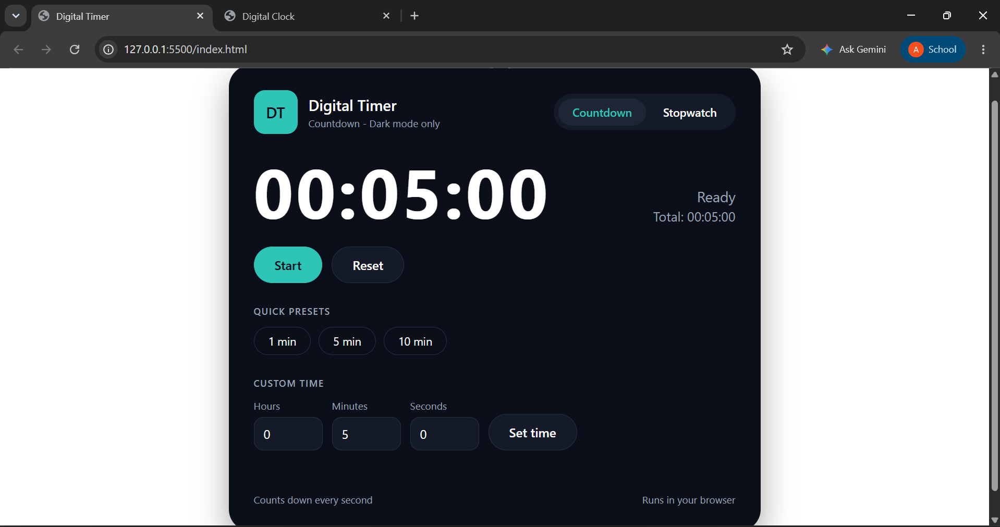

# Digital Timer ⏱️

A simple digital timer built using HTML, CSS, and JavaScript. It features countdown and stopwatch modes with interactive controls and custom time settings.

## About the Project

This is a browser-based timer application designed to help users track time using countdown and stopwatch functionality.

It was built as a practical project to improve my understanding of HTML, CSS, JavaScript, and interactive web development.

## Features

- Countdown timer.
- Stopwatch mode.
- Start, stop, and reset controls.
- Quick time presets (1, 5, and 10 minutes).
- Custom time settings (hours, minutes, and seconds).
- Alarm notification when the countdown ends.
- Dark-themed user interface.

## Technologies Used

- HTML5
- CSS3
- JavaScript

## Screenshot



## How to Run

1. Clone this repository:

   ```bash
   git clone https://github.com/raffydex/digital-timer.git
   ```

2. Open the project folder.
3. Open `index.html` in your web browser.

## Project Structure

```text
digital-timer/
│
├── index.html
├── style.css
├── script.js
├── images/
│   └── preview.png
└── README.md
```

## What I Learned

- HTML page structure.
- CSS styling and layout.
- JavaScript DOM manipulation.
- Event handling.
- Countdown and stopwatch logic.
- JavaScript timing functions.
- Handling user input.

## Author

**RAFFYDEX**

GitHub: [@raffydex](https://github.com/raffydex)

---

Built while learning and exploring frontend development